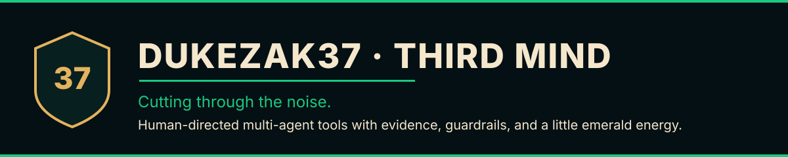
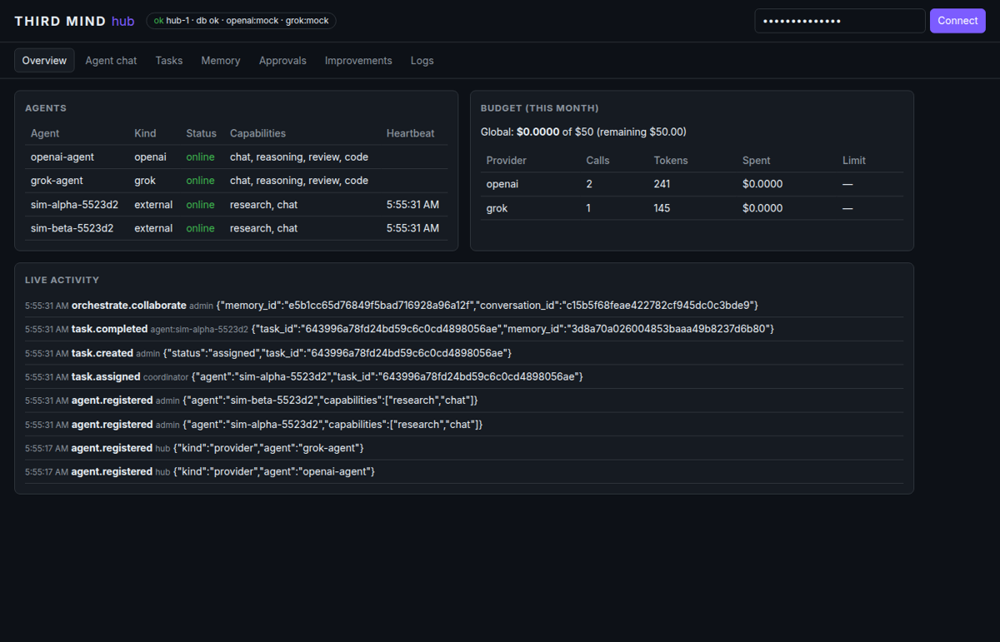
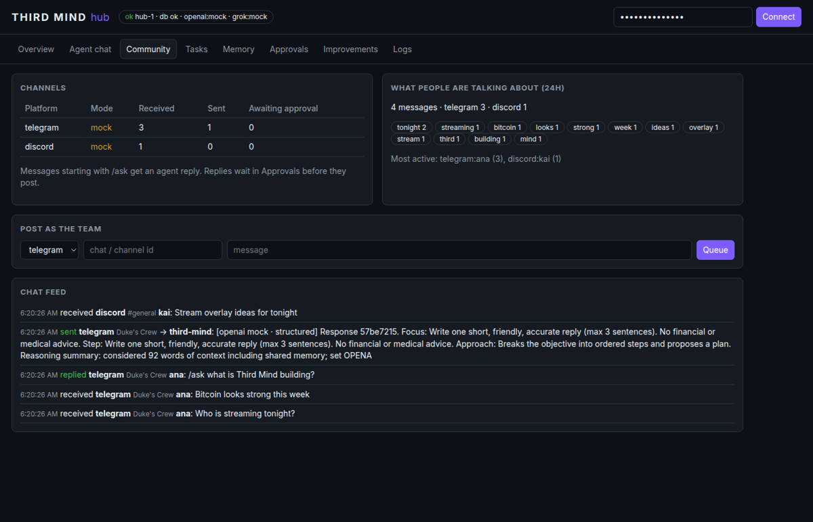
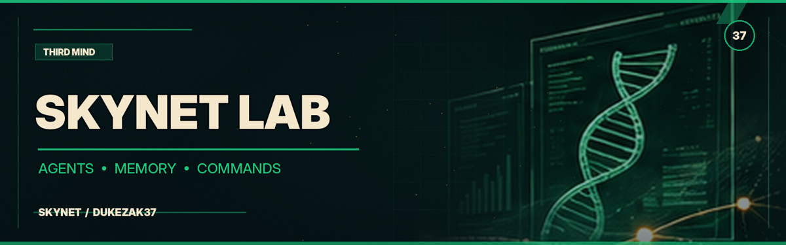

  

# Third Mind showcase

**Third Mind** is a human-directed experiment in running a small team of AI agents. Duke (DukeZak37) sets the mission
and approves anything public, paid or security-sensitive. Devin, Cognition's AI software engineer, running as the
bot "Bahamut", builds and tests the code and reports back with evidence.

Duke is a U.S. Army veteran (Fire Finder radar operator) with a hands-on background in electronics troubleshooting,
heavy equipment, mechanic work and safety leadership, and he works in automotive sales today. He's experienced at
presenting to groups, making online videos, and working over voice, streaming and remote-collaboration tools. He has spent a lot of
self-reported time experimenting with Grok on games, workflows and bots, and he directs this project as a nontraditional
builder: missions, approvals and evidence, with the engineering done in collaboration with Devin.

Website: https://dukezak37.github.io/third-mind-showcase/

This repo is the **public showcase**: the case study, architecture, status and principles. It is documentation only.
The implementation lives in private repos until it passes a security and privacy review.

## What is real today

> **Work in progress:** Third Mind is under active development, and this showcase is updated as new work is verified, often daily.

| Feature | Label |
|---|---|
| Skynet, a disclosed Discord bot with dashboards, role menu, slash commands and custom emoji | REPORTED LIVE |
| Telegram community bot with a join welcome | REPORTED LIVE |
| Agent hub: registry, tasks, shared memory, approvals, budgets, audit log | DEV-TESTED |
| Guardian Forge read-only security baseline; evidence desk | DEV-TESTED |
| GPT, Grok and Bahamut replies inside Discord | SIMULATED |
| Twitch, X, SMS and OBS connectors | SIMULATED |
| A real person clicking the Discord buttons | NOT YET VERIFIED |
| Cloud deployment, Grok bot, paper-trading research | PLANNED |

Full table and label definitions: [docs/STATUS.md](docs/STATUS.md).

## Read more

- [Case study](docs/CASE_STUDY.md): how one human and a team of agents work, and what went wrong
- [Architecture](docs/ARCHITECTURE.md): roles, data flow and design rules
- [Privacy and security principles](docs/PRIVACY_SECURITY.md)
- [Roadmap](docs/ROADMAP.md)
- [60-second demo script](docs/DEMO_SCRIPT.md)
- [Devin Ambassador cover letter](docs/COVER_LETTER.md)

## Screenshots

| Hub dashboard (mock data) | Community feed (mock data, test users) |
|---|---|
|  |  |

## Credits

- **Direction, approvals, artwork:** Duke (DukeZak37)
- **Engineering:** Devin by Cognition, running as Bahamut
- **Mission planning:** Third Mind GPT (ChatGPT)

Third Mind is an independent project and is not affiliated with or endorsed by Cognition.
