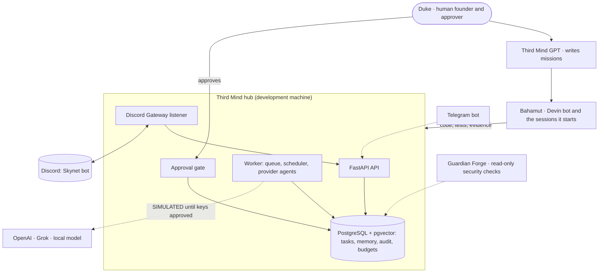

# Architecture

## Roles

| Role | Who | What it may do |
|---|---|---|
| Founder | Duke (human) | Sets missions, approves anything public, paid or security-sensitive |
| Planner | Third Mind GPT | Writes missions and reviews reports |
| Engineer | Bahamut (Devin) | Writes and tests code on a development machine, reports with evidence |
| Community bot | Skynet (Discord), Telegram bot | Acts only as a disclosed bot identity, never as Duke |

## Design rules

1. **Provenance on everything.** Each task records who asked, which agent acted and whether the result was real or simulated.
2. **Approval gate.** Posting, spending and security changes wait for a human decision.
3. **Mock first.** Every connector runs in mock mode until its credentials are configured server-side.
4. **Reversible changes.** Community-server changes are snapshotted first and come with a rollback.
5. **Scoped tokens.** Each connector gets its own narrow, revocable token; no personal logins.
