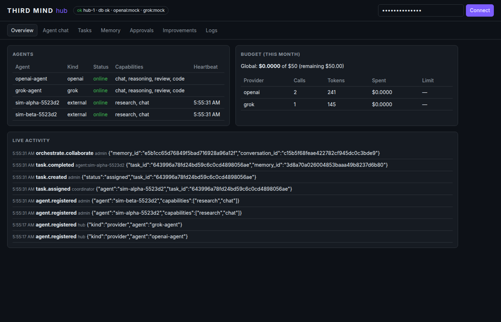

# Case study: one human, a team of AI agents, and an honest evidence trail

**Duke (DukeZak37)** founded and runs Third Mind. He's a U.S. Army veteran and former Fire Finder radar operator who works in automotive sales today, and he came to it after a lot of self-reported hands-on experimentation with Grok building games, workflows and bots. In this project the agents write the code. Duke sets the missions,
approves anything risky, and publishes what actually happened, including what is still simulated.

## How the work flows

1. Duke states a goal in plain words.
2. **Third Mind GPT** turns it into a written mission with acceptance checks and limits (no spending, no production, no personal logins).
3. **Bahamut**, a Devin bot, starts Devin sessions that build and test on a development machine and report back with IDs, hashes and test counts.
4. Duke reviews the result. Nothing public, paid or security-sensitive happens without him.

## What the team shipped in its first days

| Built | Label |
|---|---|
| Agent hub: registry, tasks, shared pgvector memory, approvals, budgets, audit log, dashboard | DEV-TESTED (78 tests rerun independently, 84 reported) |
| Skynet Discord bot: Gateway connection with fault handling, 7 slash commands, welcome dashboard, control panel, role menu | REPORTED LIVE |
| Reversible community-server remodel: categories, branded channel headers from Duke's own art, 12 custom emoji, rollback for every step | REPORTED LIVE |
| Telegram community bot with a join welcome | REPORTED LIVE |
| Guardian Forge read-only security baseline; evidence desk for reviewing agent actions | DEV-TESTED |
| GPT, Grok and Bahamut replies in Discord | SIMULATED |
| Twitch, X, SMS and OBS connectors | SIMULATED |
| Dedicated Grok Slack bot (separate from the relay), paper-trading research | PLANNED |

## What went wrong, and what it taught

- **A bot can't press its own buttons.** Automated tests simulate the click, but "verified" waits for a real person.
- **Some features cost money.** Discord server banners need paid boosts, so they were skipped under a no-spend rule.
- **Empty test databases hide bugs.** A migration that passed tests failed on real dev data. Now the stack is rebuilt with data before every report.
- **Check secrets before blaming code.** Two secrets from different providers were swapped once. Checking a token's shape before using it would have saved a debugging loop.

## What I can teach

1. Wiring a Discord bot to an agent hub with signed interactions, deduplication, rate limits and an audit log.
2. Provenance: every reply says who asked, which agent acted, and whether it was real or simulated.
3. Approval gates for posting, spending and security changes.
4. Keeping status labels honest as a project grows.
